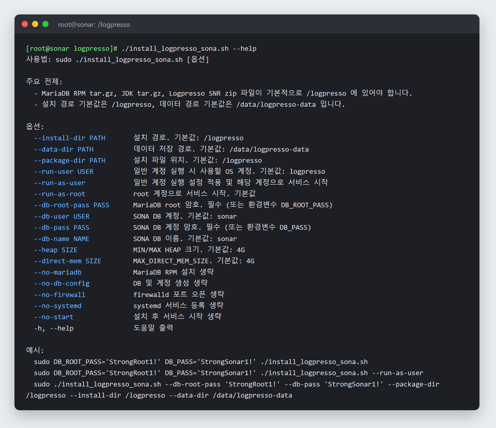

# logpresso-sonar-installer

로그프레소 소나(Logpresso Sonar) 단독형 서버를 **쉘 한 번 실행으로 설치**하는 자동화 스크립트입니다.
설치 가이드(웹 인스톨러 방식)의 수작업 절차를 그대로 옮겨, OS 설치 직후 실행하면 DB·JDK·로그프레소 설치부터 OS 설정, 서비스 등록까지 끝냅니다.



## 만든 이유

로그프레소를 재구축할 때 IDC 현장 작업 시간은 정해져 있는데, 설치 절차가 길고 단계마다 손이 들어가 실수 여지가 컸습니다.
사내 테스트 서버에서 이 스크립트를 미리 반복 검증해 두고, 현장에서는 설치 파일을 넣고 실행만 하는 방식으로 작업 시간을 줄였습니다.

## 하는 일

| 단계 | 내용 |
|---|---|
| OS 사전 설정 | SELinux 비활성화, firewalld 포트 개방 (TCP 443·8443·3306·7140·44300·18443 / UDP 514·162) |
| MariaDB | RPM 오프라인 설치, utf8 문자셋 설정, Sonar DB·계정 생성 |
| JDK | 압축 해제 후 `jre` 심볼릭 링크 생성 |
| 로그프레소 | SNR 패키지 압축 해제, `logpresso.conf`의 힙·Direct Memory·데이터 경로 설정 (원본 자동 백업) |
| 일반 계정 실행 (선택) | 계정 생성, ulimit, `setcap`으로 443 포트 바인딩, sudoers 최소 명령 등록 |
| 커널 튜닝 | 대량 syslog 수신 시 UDP 유실 방지를 위한 수신 버퍼(sysctl) 확대 |
| 서비스 | systemd 등록 및 시작, 완료 후 웹 인스톨러 다음 단계 안내 |

## 요구 사항

- Rocky Linux / RHEL 9 계열, root 권한
- 설치 파일을 패키지 경로(기본 `/logpresso`)에 미리 준비 (인터넷 연결 불필요)
  - `MariaDB*.tar.gz` (RPM 묶음)
  - `jdk-*.tar.gz`
  - `logpresso-SNR-*.zip`
- `unzip`

## 사용법

```bash
chmod +x install_logpresso_sona.sh

# 기본 경로로 설치
sudo DB_ROOT_PASS='<MariaDB root 암호>' DB_PASS='<Sonar DB 암호>' ./install_logpresso_sona.sh

# 데이터 경로·메모리 지정, 일반 계정으로 실행
sudo ./install_logpresso_sona.sh \
  --db-root-pass '<MariaDB root 암호>' --db-pass '<Sonar DB 암호>' \
  --data-dir /data/logpresso-data --heap 8G --direct-mem 8G --run-as-user
```

전체 옵션은 `./install_logpresso_sona.sh --help`로 확인할 수 있습니다.
설치가 끝나면 `https://<서버IP>` 웹 인스톨러에서 관리자 계정과 DB 정보를 입력해 마무리합니다.

## 보안 고려 사항

- DB 암호는 스크립트에 기본값을 두지 않고 실행할 때 옵션이나 환경변수로 받습니다. 지정하지 않으면 아무것도 설치하기 전에 멈춥니다.
- 암호가 들어간 SQL은 권한 600 임시 파일로 실행한 뒤 바로 삭제하고, 설치 로그와 안내 화면에도 암호를 출력하지 않습니다.
- 일반 계정 실행 시 root 권한 대신 `setcap`으로 필요한 포트 바인딩 권한만 주고, sudoers는 운영에 필요한 명령만 등록한 뒤 `visudo`로 문법을 검증합니다.

## 동작 방식

- `set -Eeuo pipefail`로 한 단계라도 실패하면 즉시 중단합니다.
- 모든 단계는 `/var/log/logpresso_sona_install_<시각>.log`에 기록되어, 문제가 생기면 어느 단계에서 멈췄는지 바로 확인할 수 있습니다.
- `logpresso.conf`는 값을 바꾸기 전에 원본을 백업하고, 설정 파일에 이미 있는 값은 중복으로 추가하지 않습니다.

## 참고

- SELinux를 `disabled`로 바꾸는 설정은 재부팅 후 완전히 적용됩니다.
- 고객사 환경 정보는 제외한 일반화 버전입니다.
